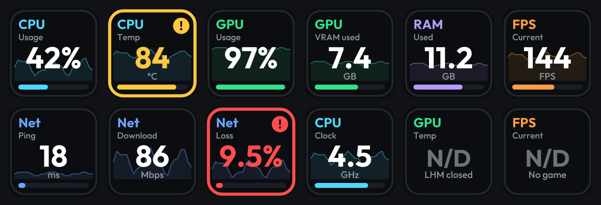

# Ulanzi Deck System Monitor Pro

Plugin open source planejado para Ulanzi D200 / Ulanzi Studio: métricas de CPU, GPU, RAM, VRAM, FPS e rede, com alertas configuráveis.

> **Status atual:** protótipo funcional, ainda sem uso no Ulanzi Studio nem em um dispositivo. As teclas, o painel e os leitores (memória, LibreHardwareMonitor, rede, ping e FPS por CSV) existem e são testados contra hosts e sensores simulados. Nada foi visto num D200, e os sensores nunca foram lidos de um LibreHardwareMonitor real. [docs/VERIFY.md](docs/VERIFY.md) é o roteiro da primeira execução real.

**Para ver CPU e GPU** o [LibreHardwareMonitor](https://github.com/LibreHardwareMonitor/LibreHardwareMonitor) precisa estar aberto, com *Options > Remote Web Server > Run* ligado. Memória, velocidade da rede e ping não precisam de mais nada. Cada leitura que falta diz o motivo na própria tecla.

## Objetivos
- Hardware: sensores disponibilizados pelo LibreHardwareMonitor, com detecção de indisponibilidade.
- FPS: adaptador RTSS ou PresentMon condicionado à verificação das interfaces e limitações reais.
- Rede: upload/download por interface, RTT/ping, jitter e perda em janelas explícitas.
- UI: cores dinâmicas, thresholds configuráveis, histerese e alertas sem flicker.
- Privacidade: medições locais e destinos de ping configuráveis, sem telemetria enviada a servidor do produto.

## Princípios
- Consultar SDK oficial Ulanzi antes de escrever a integração; não inventar métodos.
- Telemetria compartilhada entre botões, coleta por frequência configurável, render por mudança material.
- Valores ausentes mostrados como N/D; nunca substituir falha por zero.
- Verificar licenças de dependências antes de incluir binários.

## Estrutura
- `docs/ARCHITECTURE.md`: arquitetura, contratos e fases
- `docs/IMPLEMENTATION.md`: de onde vem cada leitura, o que cada tecla mostra e o que ainda falta
- `com.ulanzi.systemmonitorpro.ulanziPlugin/plugin/defaults.json`: limites e intervalos
- `.github/workflows/ci.yml`: validação básica do scaffold (não é teste do plugin)

## Desenvolvimento
Ainda não existe build executável do plugin. O plano é implementar primeiro o contrato de métricas e o renderer com stub Ulanzi, depois LHM, FPS, rede e Property Inspector. Testes no Ulanzi Studio e D200 deverão ser executados antes de uma release.

Contribuições são bem-vindas após definição de licença e fluxo de PRs.
